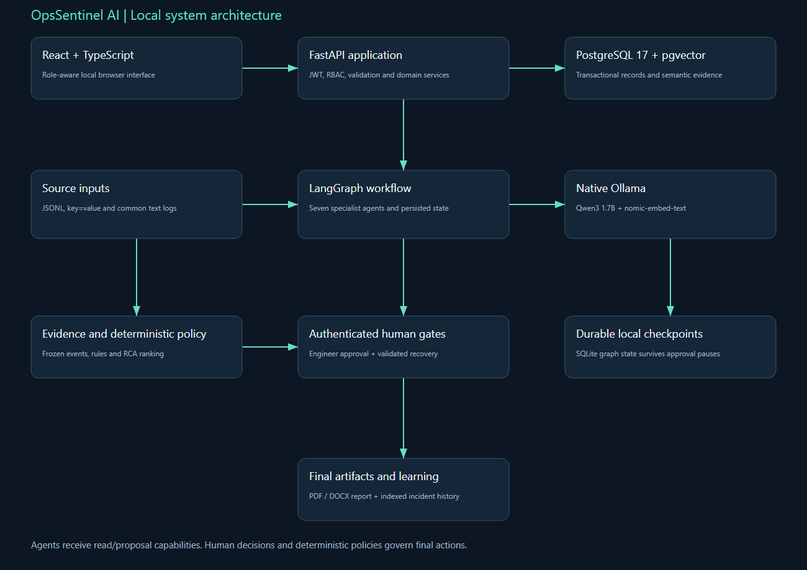
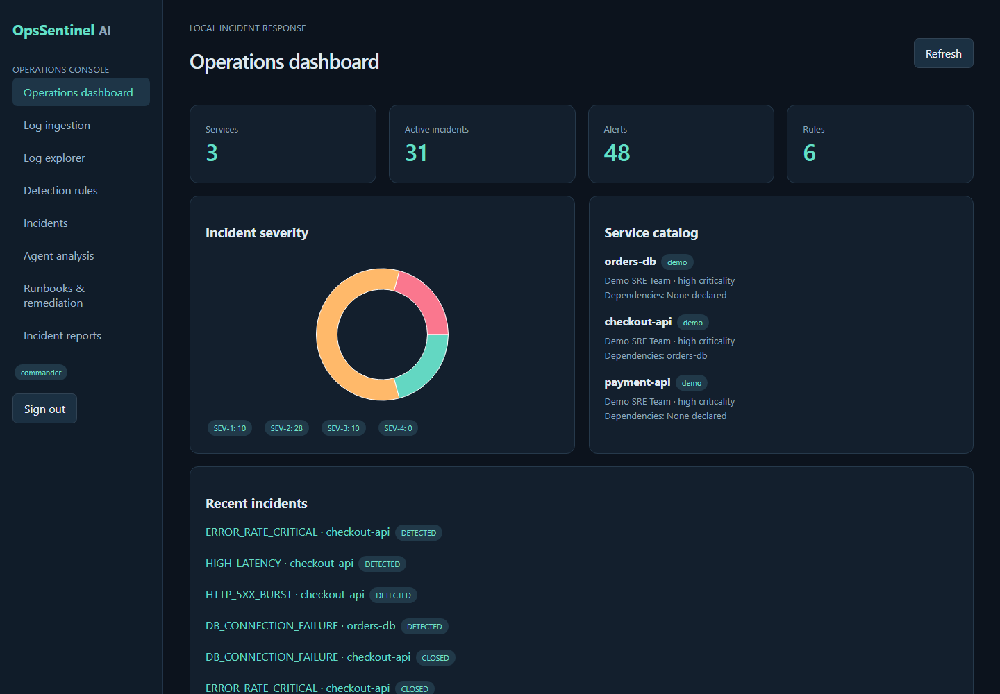
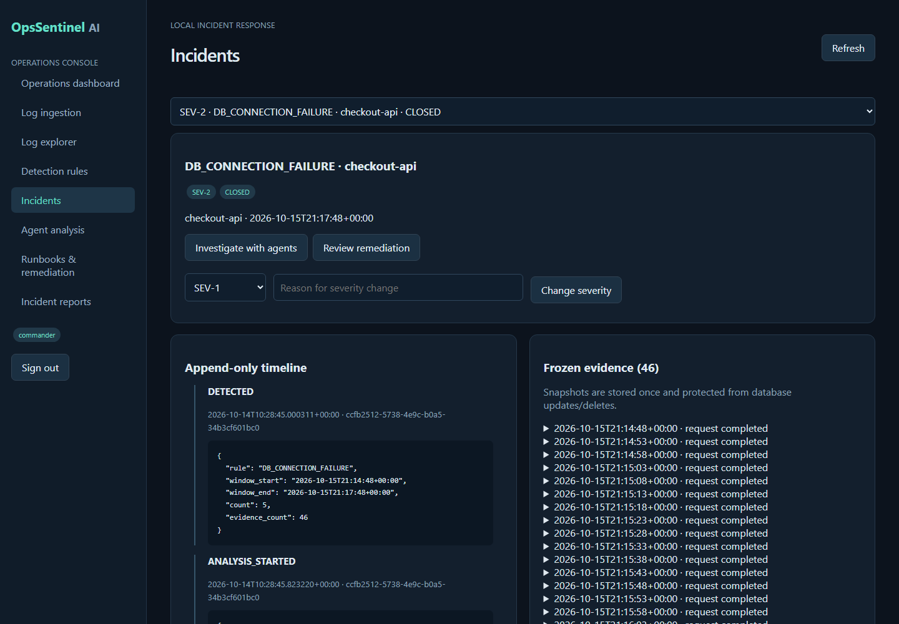
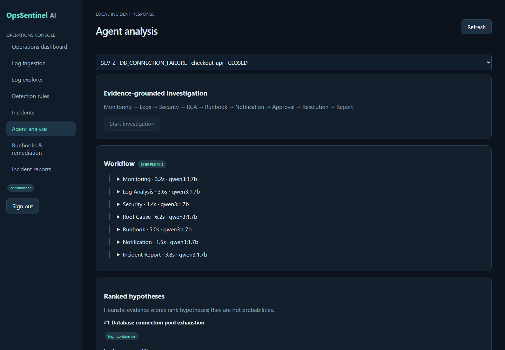
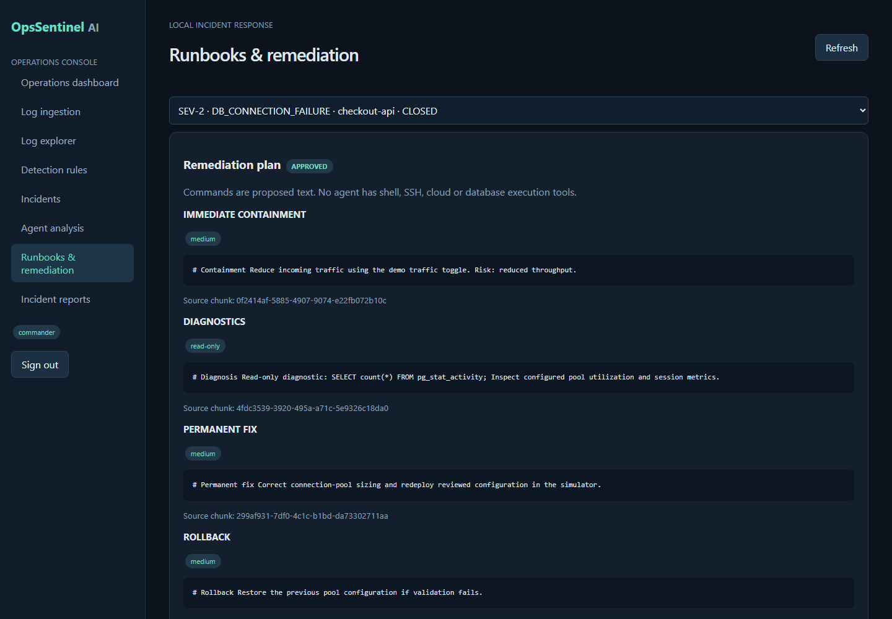

# OpsSentinel AI — Technology, Implementation & Interview Guide

Prepared for Venkata Yaswanth Ram Pamarthi from the supplied implementation blueprint, resume context, actual project source and locally recorded test runs. This companion explains what the implementation does and where to inspect it. It describes a local portfolio MVP; claims about production integrations, arbitrary-document accuracy or deployed cloud operations are outside the implemented scope.

Project folder: D:\projects\opsSentinel. Interface: http://localhost:5174. Swagger: http://127.0.0.1:8001/docs. Local account details are in private LOGIN.txt. Do not copy passwords or .env into interview slides, a repository or screenshots.

## 1. Project summary and business value

An engineer uploads, pastes or submits JSON telemetry. Three parsers produce a canonical event schema, UTC timestamps and stable hashes. A deterministic rule evaluates sliding windows and creates a deduplicated alert and incident. Related events are frozen, then Monitoring, Log Analysis, Security, Root Cause, Runbook and Notification specialists produce structured evidence-linked outputs. The graph waits for engineer approval, then waits separately for actual action and recovery validation. Incident Report runs after that record; a commander closes the incident and generates the final report, which is indexed as historical knowledge.

The portfolio value is the complete traceable process: source input, validated data, persisted specialist work, reviewable evidence, human authority and a final downloadable artifact. The supplied resume lists seven agents per project, and all seven are implemented rather than omitting the optional spend/notification specialists.

## 2. Exact local technology stack and responsibility

```
alembic==1.20.0
fastapi==0.143.0
langgraph==1.2.15
pgvector==0.5.1
psycopg==3.3.6
pwdlib==0.3.1
pydantic==2.14.1
PyJWT==2.15.1
pypdf==6.20.1
pytest==9.1.1
python-docx==1.2.0
reportlab==5.0.1
SQLAlchemy==2.1.4
```

Frontend exact installed versions are recorded by package-lock.json. The package manifest declares the requested dependency families; the lock file is used by npm ci to reproduce installed versions. Node on the verified machine is v24.21.0; Python used for the projects is 3.12.10; Docker server is 29.8.2; Ollama is 0.40.4.

### Python 3.12

Purpose: Backend business logic, parsing, orchestration and report generation.

How implemented: Python is pinned to the guide's broad-compatibility version. Each backend has its own virtual environment; startup calls its Python directly so PowerShell activation policy is irrelevant. Domain arithmetic and validation execute in ordinary Python functions rather than model-generated code.

### FastAPI + Pydantic

Purpose: Typed REST endpoints, dependency-based authentication and request/output validation.

How implemented: main.py registers domain routes and exposes Swagger at /docs. Pydantic validates positive values, allowed statuses and required reasons. Authentication and role dependencies run before endpoint logic. BackgroundTasks starts bounded graph work, and the frontend polls persisted run state every two seconds.

### SQLAlchemy + psycopg

Purpose: Parameterized database access and relational source of truth.

How implemented: core.py creates a connection pool and a session factory. models.py defines relational tables and foreign keys. Endpoint transactions commit business changes and audit records together. Connections use 127.0.0.1 with a timeout because localhost resolution stalled on this Windows machine. No endpoint interpolates user input into SQL.

### Alembic

Purpose: Repeatable schema migrations.

How implemented: Revision 001 creates the vector extension and application tables. Revision 002 adds database triggers for append-only evidence or audit history. Setup and Start run alembic upgrade head. Migration order is versioned, so a fresh database can reproduce the schema without manual table creation.

### PostgreSQL 17 + pgvector

Purpose: Relational records and local semantic similarity in one database.

How implemented: Docker Compose runs pgvector/pgvector:pg17 with a named persistent volume and a health check. Embedding columns use Vector(768). Retrieval joins ownership metadata before ordering by cosine distance. Exact search is used at this demonstration scale; HNSW and hybrid ranking remain possible extensions when measurement justifies them.

### LangGraph

Purpose: Explicit specialist workflow, persisted shared state and human approval pauses.

How implemented: workflows.py declares TypedDict state and named specialist nodes. SqliteSaver persists local checkpoints under storage; business records and agent outputs remain in PostgreSQL. interrupt pauses the graph, and Command(resume=...) continues the same run/thread. A checkpoint survives an API restart. The small laptop serializes actual generation calls even where procurement graph specialists fan out logically.

### Ollama + Qwen3 1.7B

Purpose: Local structured language-model explanations.

How implemented: ai.py calls the native Windows Ollama /api/chat endpoint. The RTX 3050 has 4 GB VRAM, so the guide's 1.7B fallback is used with a 4096-token context, temperature zero and bounded output. JSON schema constrains responses and allowed citation IDs. The adapter validates output, retries once with feedback, and stops visibly after a second invalid result.

### nomic-embed-text

Purpose: Local learned embeddings for retrieval.

How implemented: The /api/embed endpoint converts source chunks and search queries to 768-dimensional vectors. Document vectors are persisted rather than recomputed on every question. Generation and embeddings are separate models and responsibilities. An explicitly labelled deterministic test mode is available for isolated testing; verified demo runs use real Ollama inference and nomic embeddings.

### React + TypeScript + Vite

Purpose: Interactive role-aware local interface.

How implemented: The frontend separates an API client from application screens and focused editing/viewer components. Vite proxies /api to the relevant local backend. TypeScript checks the build, browser sessionStorage holds the short-lived JWT, and React renders text with escaping. Forms show loading and server validation errors; report downloads authenticate fetch requests before saving blobs.

### Recharts

Purpose: Dashboard and comparison visualizations.

How implemented: Charts render RFQ/vendor decision information or incident severity counts from API values. They summarize already persisted facts and do not manufacture predictions. The score table still exposes exact numbers and factor contributions; the chart is an aid to explanation rather than the source of the decision.

### pypdf

Purpose: Digital-PDF runbook extraction; source log inputs remain text/JSON.

How implemented: PDF uploads validate extension, MIME, magic bytes, file size and reader compatibility. Extracted page text is split into bounded sections with overlap. Each chunk retains a document ID, page and content hash. Nearly empty pages are labelled OCR_REQUIRED. OCR is an optional path in the source guides, so this implementation makes the missing capability explicit instead of inventing text.

### ReportLab + python-docx

Purpose: Downloadable PDF and Word artifacts.

How implemented: reports.py renders immutable decision facts into readable report artifacts. PDF text is escaped and Word content is generated locally. Report endpoints require the appropriate finalized human workflow and reuse an existing report record on retry. The file download endpoint checks authentication and object access before serving generated names.

### Argon2 + JWT

Purpose: Local authentication and role enforcement.

How implemented: Passwords are hashed with pwdlib Argon2; JWTs carry the user ID and a 60-minute expiry and are verified with a generated local secret. Public registration in procurement creates analysts only. Manager or commander accounts are seeded locally. Database credentials, signing secrets and demo passwords live in .env and private LOGIN.txt, both excluded from version control.

### pytest + Vitest + Playwright

Purpose: Unit, API, frontend network-boundary and browser verification.

How implemented: pytest exercises domain safeguards, authentication and evidence rules. Vitest tests JSON and multipart API-client behavior and error propagation. Playwright signs in, navigates every screen, inspects completed workflows, checks source evidence and downloads reports. Actual API replay scripts additionally exercise the real LLM and PostgreSQL rather than substituting mocked inference.

### Docker Desktop, PowerShell and Git

Purpose: Repeatable local operation and source control.

How implemented: Docker runs only the database; backend, frontend and Ollama run natively. PowerShell Setup, Start, Stop, Doctor and Test scripts keep commands repeatable and log launcher processes. Git excludes models, .env, uploads, reports, databases and dependency directories. This arrangement follows the laptop architecture in the supplied implementation guides.

## 3. Architecture and important data boundaries

The browser calls a localhost Vite proxy, which forwards authenticated requests to one FastAPI application. Relational business records and 768-dimensional vectors are persisted in PostgreSQL. Uploaded sources and generated reports use controlled storage directories. Ollama runs natively with GPU inference. LangGraph checkpoint files are local SQLite state; they complement, rather than replace, PostgreSQL business records.

```
flowchart LR
      Browser[React TypeScript UI] --> API[FastAPI role and object checks]
      API --> DB[(PostgreSQL 17 + pgvector)]
      API --> Files[Local uploads and reports]
      API --> Graph[LangGraph specialist workflow]
      Graph --> Ollama[Native Ollama Qwen3 1.7B]
      Graph --> Checkpoint[(Durable SQLite checkpoints)]
      Ollama --> Evidence[Validated JSON and allowed evidence IDs]
      Graph --> Human[Authenticated human review]
      Human --> Final[Final report with audit history]
```



Generation can explain supplied evidence, but deterministic services own authoritative calculations and lifecycle transitions. A source document/log is treated as untrusted data. A retrieved chunk supplies content and provenance, not instructions. Approval is an application record that resumes a particular graph thread; the model cannot self-approve or bypass the role dependency.

## 4. Source code walkthrough

| Backend module | What to explain |
| --- | --- |
| core.py | Settings, paths, SQLAlchemy engine/session, password hashing, JWT, current user, role and ownership dependencies, audit utility. |
| models.py | Tables, foreign keys, unique constraints, persisted business state, source evidence, agent runs/outputs and approval/report records. |
| schemas.py | Typed request and domain contracts, positive-value constraints, allowed decisions/statuses and mandatory business fields. |
| ai.py | Embedding and structured-generation HTTP clients, GPU call serialization, citation schema, bounded evidence packet and one repair attempt. |
| workflows.py | Shared state, specialist nodes, persistent graph compilation, interrupt/resume handling, run status and visible failures. |
| reports.py | Escaped local PDF and DOCX generation from persisted human decisions and facts. |
| main.py | REST routes, permissions, uploads, business transaction boundaries, background execution, report/download policy and health endpoint. |
| ingestion.py | Three-format normalization, UTC handling, secret redaction, semantic event hash, bulk inserts and parser statistics. |
| detection.py | Rule definitions, deque-based sliding windows, per-IP/host grouping, episode deduplication, incident creation and frozen evidence. |
| knowledge.py | Heading-aware runbook ingestion, version/environment metadata, local vectors, historical-report ingestion and cosine retrieval. |
| rca.py | Error signatures, trace groups, facts, hypothesis score breakdown, missing evidence and risk-marked remediation sections. |

Frontend source begins at src/main.tsx. App.tsx provides the role-aware pages, api.ts owns authenticated JSON/multipart requests and blob downloads, and style.css defines the responsive local interface. Procurement also has PdfViewer.tsx and RFQEditor.tsx; operations has RuleManager.tsx. Tests and scripts demonstrate these modules through public APIs rather than editing the database to manufacture a successful path.

## 5. Database model and persisted evidence

| Actual table | Persisted fields |
| --- | --- |
| users | id, email, password_hash, role |
| activity_logs | id, actor_id, action, entity_id, metadata_json, timestamp |
| services | id, name, environment, criticality, owner, dependencies_json |
| log_sources | id, service_id, name, type, parser_config |
| log_events | id, timestamp, service_id, level, message, trace_id, host, source_type, attributes, raw_line, original_timestamp, parse_status, hash |
| detection_rules | id, name, query_type, pattern, threshold, window_seconds, severity, enabled |
| alerts | id, rule_id, service_id, window_start, window_end, event_count, dedupe_key |
| incidents | id, alert_id, title, severity, status, service_id, detected_at, commander_id, resolution_json |
| incident_events | id, incident_id, event_id, relationship, snapshot_json, frozen_at |
| timeline_entries | id, incident_id, type, timestamp, actor, payload_json |
| agent_runs | id, incident_id, workflow, status, model, started_at, completed_at, error |
| agent_outputs | id, run_id, agent_name, schema_version, prompt_version, started_at, completed_at, inputs_json, payload_json, model_json |
| rca_hypotheses | id, incident_id, run_id, rank, cause, evidence_json, score, confidence |
| runbooks | id, service_id, title, version, environment, content, status |
| knowledge_chunks | id, service_id, source_type, source_id, section, version, environment, text, embedding |
| remediation_proposals | id, incident_id, run_id, status, payload_json, executed |
| approvals | id, proposal_id, engineer_id, decision, reason, timestamp |
| incident_reports | id, incident_id, run_id, version, files_json, generated_at |

Foreign keys link business objects to their evidence and human actors. Unique constraints enforce source deduplication and one decision per recommendation/proposal. PostgreSQL JSON fields preserve structured specialist/domain payloads, while explicit columns retain identities and lifecycle status for queries. Vector columns contain learned nomic embeddings. Audit/evidence triggers reject UPDATE or DELETE on protected records even if a caller bypasses the web interface.

## 6. Complete process, node contracts and failure routing

```
import sqlite3, threading
from typing import TypedDict
from sqlalchemy import select
from langgraph.graph import StateGraph, START, END
from langgraph.types import interrupt, Command
from langgraph.checkpoint.sqlite import SqliteSaver
from .core import ROOT, Session, now, uid
from .models import Incident, IncidentEvent, Service, Run, Output, Hypothesis, Proposal
from .detection import timeline
from .knowledge import retrieve
from .ai import commentary
from .rca import analyze, proposal_from_knowledge


class State(TypedDict, total=False):
    incident_id: str
    run_id: str
    monitoring: dict
    logs: dict
    security: dict
    rca: dict
    runbook: dict
    notification: dict
```

| Agent | Input contract | Output/failure rule |
| --- | --- | --- |
| Monitoring | Matched rule, service and frozen events | Detection/severity summary; cannot suppress the rule alert |
| Log Analysis | Frozen incident events | Error signatures, chronological order and shared trace groups |
| Security | Relevant authentication events | Indicators/source IPs and explicit missing identity/threat data |
| Root Cause | Evidence, dependency hints and retrieved knowledge | Confirmed facts, ranked hypotheses, contradictions, missing metrics and scoring |
| Runbook | Top hypothesis and service-filtered knowledge | Cited diagnosis, containment, fix, rollback and validation; risk notes |
| Notification | Incident state and audience context | Local message preview with sent=false |
| Incident Report | Timeline, engineer decision and validated actual recovery | Post-incident report model preserving the immutable source chronology |

Every completed specialist persists its prompt version, schema version, evidence IDs, model metadata, structured payload, start and end time. Generation output is validated before the node output is considered successful. A second invalid response records a FAILED run. Missing prerequisites generate a visible NEEDS_INPUT or failure message and allow the user to supply the required data. Human review nodes use persisted graph interruption rather than a frontend-only toggle.

The workflow contains two separate pauses: one for proposal approval and another for actual recovery validation. Rejection or revision returns the incident to investigation. A completed proposal never implies a live infrastructure action; execution remains outside registered agent capabilities. Commander closure checks resolved state, existing validation evidence and completed report generation.

## 7. Authoritative domain logic and reproducibility

```
from collections import defaultdict
from .ingestion import signature


def analyze(events, service, knowledge):
    ordered = sorted(events, key=lambda e: (e["timestamp"], e["id"]))
    failure_patterns = (
        "connection timeout",
        "connection refused",
        "failed login",
        "authentication failed",
        "restart",
    )
    errors = [
        e
        for e in ordered
        if e["level"] in ("ERROR", "CRITICAL")
        or float(e["attributes"].get("http_status", 0)) >= 500
        or float(e["attributes"].get("latency_ms", 0)) > 2000
        or any(pattern in e["message"].lower() for pattern in failure_patterns)
    ]
    groups = defaultdict(list)
    for e in errors:
        groups[signature(e["message"])].append(e["id"])
    facts = [{"statement": f"{e['timestamp']}: {e['message']}", "event_ids": [e["id"]]} for e in errors[:8]]
    db = [
        e
        for e in errors
        if "connection timeout" in e["message"].lower() or "connection refused" in e["message"].lower()
    ]
    auth = [
        e
        for e in errors
        if "failed login" in e["message"].lower() or "authentication failed" in e["message"].lower()
    ]
    restart = [e for e in ordered if "restart" in e["message"].lower()]
    slow = [e for e in ordered if float(e["attributes"].get("latency_ms", 0)) > 2000]
    templates = [
```

### Why do rules create incidents before agents?

Known operational failure patterns need fast, reproducible detection. HTTP bursts, database connection failures, sustained latency, failed logins, restart loops and critical error ratios have explicit thresholds and time windows. The model is invoked after a meaningful alert exists, where summarization and interpretation add value. This reduces GPU workload and makes detection independently testable. Future statistical anomaly detection would require historical telemetry and evaluation data, which the prepared simulator does not supply.

### Explain the sliding-window implementation.

Events are sorted by UTC timestamp and scanned with a deque per service/rule, with authentication grouped by source IP and restart events by host. Old events leave the configured interval as the scan advances. Count-based rules inspect matching events; critical ratio requires more than 20 requests and more than 50 percent failures, and latency requires a sustained sample rather than one slow request. A continuous threshold episode generates one crossing identity, and the unique dedupe key prevents repeat evaluation from creating another alert.

### How is malformed telemetry handled?

Normalization tries JSON first, key=value second and configured common text third. A malformed line is retained with partial parse status and raw content rather than failing the batch. Unknown timestamps are marked partial and are not used to fabricate a current failure window. Timestamps that can be parsed are normalized to UTC while original timestamp strings remain available. The parser diagnostics show retained, partial, duplicate and unregistered-service counts.

### How is correlation implemented?

The evidence packet includes the service's time window and declared dependencies, with available post-trigger context frozen once. Log Analysis groups normalized error signatures and shared trace IDs. For the database-pool scenario, orders-db timeouts precede checkout errors, and the declared dependency explains the relationship. Time correlation supports a hypothesis, not proof of causality; missing pool/session metrics remain explicit.

### What is an immutable evidence window?

IncidentEvent stores each referenced event and a JSON snapshot at detection time. Timeline entries append detection, specialist completion, approval and resolution events. PostgreSQL triggers reject updates/deletes to these tables, and no editing endpoint is exposed. Later ingested telemetry does not silently change the source packet used by RCA. Recovery validation is recorded as a separate human action so the initial evidence and final outcome can both be inspected.

### Explain the RCA score.

A hypothesis receives 30 for explaining the first failure, 25 for covering most error evidence, 20 for an actual similar resolved incident, 15 for consistent declared dependency and potentially 10 for later confirmed remediation, with strong contradictions subtracting 25 each. The implementation stores a visible score breakdown and ranks candidate causes deterministically. Initial analysis leaves resolution confirmation at zero. The score is a heuristic ordering, and high/medium/low confidence labels are not calibrated probabilities.

### How do runbooks become remediation proposals?

Knowledge ingestion accepts Markdown, text or digital PDF, splits sections by headings and embeds local chunks with service, environment, source type and version metadata. Retrieval returns cited sections and flags outdated runbooks. The Runbook node sorts retrieved sections into diagnosis, containment, permanent fix, rollback and validation. The most relevant runbook is expanded to include every procedure section, rather than using only the top individual chunks. Missing sections or an outdated source block approval and require revision. Risk badges identify read-only diagnostics, medium-risk changes and destructive terms.

## 8. REST API catalogue and how the UI uses it

| Actual endpoint | Responsibility |
| --- | --- |
| GET /health | Health |
| POST /auth/login | Authenticate |
| GET /services | Services |
| POST /services | Add Service |
| PATCH /services/{id} | Edit Service |
| GET /log-sources | Sources |
| POST /log-sources | Add Source |
| POST /logs/paste | Paste |
| POST /logs/events | Events |
| POST /logs/upload | Upload |
| GET /logs/search | Search |
| GET /rules | Rules |
| POST /rules | Add Rule |
| PATCH /rules/{id} | Edit Rule |
| POST /rules/evaluate | Evaluate Rules |
| GET /alerts | Alerts |
| GET /incidents | Incidents |
| GET /incidents/{id} | Detail |
| PATCH /incidents/{id}/severity | Severity |
| PATCH /incidents/{id}/status | Status |
| POST /incidents/{id}/analysis-runs | Analyze Incident |
| GET /analysis-runs/{id} | Run Detail |
| POST /proposals/{id}/decision | Decision |
| POST /incidents/{id}/resolve | Resolve |
| GET /runbooks | Runbooks |
| POST /runbooks | Add Runbook |
| POST /knowledge/upload | Upload Knowledge |
| GET /knowledge/search | Knowledge Search |
| POST /incidents/{id}/report | Report |
| GET /reports/{id}/{format} | Download Report |

The generated Swagger schema is the executable API contract. Use the Authorize button with a login token to exercise protected routes. The frontend uses the same public endpoints and displays server validation errors. Manager/commander-only controls are hidden or disabled appropriately, but security is enforced again by the backend; changing browser JavaScript cannot grant a privileged role.

## 9. Windows setup, execution and repeatable operations

```
cd D:\projects\opsSentinel
powershell -ExecutionPolicy Bypass -File scripts\Setup.ps1
powershell -ExecutionPolicy Bypass -File scripts\Start.ps1
powershell -ExecutionPolicy Bypass -File scripts\Doctor.ps1
powershell -ExecutionPolicy Bypass -File scripts\Test.ps1
```

Prerequisites are Python 3.12, Node 24, Docker Desktop with a running WSL2 engine, and native Ollama. Pull qwen3:1.7b and nomic-embed-text before seeding. Setup retains an existing .env, installs pinned backend/frontend dependencies, starts the database, upgrades migrations, builds the frontend and seeds synthetic data. Start launches missing native API/UI processes in hidden windows and records logs. Stop stops only recorded project launcher processes and retains database volumes and models.

Both projects can run together without port collisions. Procurement uses database 5432, API 8000 and UI 5173. Operations uses database 5433, API 8001 and UI 5174. Ollama is shared at 11434. For stable timing, run only one project's model analysis at a time and avoid concurrent embedding jobs. A model fitting on disk does not guarantee spare VRAM; the fallback and short context keep the demo practical.

For manual startup, run docker compose up -d --wait db in the root; run backend/.venv/Scripts/python.exe -m uvicorn app.main:app --host 127.0.0.1 --port 8001 from backend; run npm run dev from frontend. Environment examples contain placeholders, while scripts/configure.py generates local random secrets. The private LOGIN.txt lists the actual local accounts without exposing passwords in source or screenshots.

## 10. Measured validation and acceptance evidence

| Executed path | Status | Agents | Analysis seconds | Model |
| --- | --- | --- | --- | --- |
| db-pool-exhaustion | CLOSED | 7 | 22.56 | qwen3:1.7b |
| auth-brute-force | CLOSED | 7 | 20.22 | qwen3:1.7b |
| payment-api-latency | CLOSED | 7 | 22.28 | qwen3:1.7b |
| deployment-restart-loop | CLOSED | 7 | 20.23 | qwen3:1.7b |
| critical-error-rate | CLOSED | 7 | 22.28 | qwen3:1.7b |

Procurement acceptance tests cover valid arithmetic and weights, zero/missing values, mixed currencies, hard eligibility, three labelled PDFs, exact contract excerpts, role permissions, immutable audit history and malformed model output repair. Operations tests cover three parsers, malformed-line retention, secret redaction, UTC timestamps, canonical hashing, burst/ratio/latency thresholds, evidence ranking, text-only command risk flags and immutable incident evidence/timeline.

| Restart test | Before | After | Agents | Passed |
| --- | --- | --- | --- | --- |
| opsSentinel | WAITING_RESOLUTION | COMPLETED | 7 | True |

| Decision | Proposal result | Incident result | Executed |
| --- | --- | --- | --- |
| reject | REJECTED | INVESTIGATING | False |
| revise | REVISION_REQUIRED | INVESTIGATING | False |

The frontend test suite checks authenticated JSON requests, multipart boundary handling, visible server errors and read-only GET behavior. Playwright verifies every page, completed workflow visibility and an authenticated report download. Browser screenshots and video artifacts are stored under docs/screenshots and docs/demo. The real API execution-results.json contains run/entity/report IDs so each measured result can be inspected in the application.

```
{
  "browser": "Playwright Chromium",
  "pages": 8,
  "checks": [
    "Navigated Operations dashboard",
    "Navigated Log ingestion",
    "Navigated Log explorer",
    "Navigated Detection rules",
    "Navigated Incidents",
    "Seven-agent completed workflow visible",
    "Navigated Agent analysis",
    "Navigated Runbooks & remediation",
    "Browser PDF report download passed",
    "Navigated Incident reports"
  ],
  "javascript_errors": [],
  "passed": true
}
```

```
{
  "lines": 10000,
  "roundtrip_seconds": 9.24,
  "target_seconds": 30,
  "passed": true,
  "ingestion": {
    "input_lines": 10000,
    "inserted": 10000,
    "duplicates": 0,
    "partial": 0,
    "retained": 10000,
    "unregistered_services": [],
    "duration_seconds": 9.187
  }
}
```

Prepared-data quotation fields and high-risk excerpt citations are validated separately from model commentary. Valid schema and valid citation IDs do not by themselves prove every generated sentence correct. RCA scores order evidence-backed hypotheses and do not claim statistical calibration. Timing numbers are measured on this Windows laptop after setup; a cold model load or another GPU workload can increase latency.

## 11. Requirement-by-requirement implementation traceability

| Guide ID | Implemented process | Source location | Verification |
| --- | --- | --- | --- |
| FR-01 | Monitored services and dependencies | models.py Service; /services routes | Three seeded services and service catalog UI |
| FR-02 | Paste/upload/JSON ingestion | main.py log routes; ingestion.py ingest | API replay plus upload-format browser screen and parser diagnostics |
| FR-03 | Three canonical parsers | ingestion.py normalize/redact | JSON, key=value, common text, malformed and UTC tests |
| FR-04 | Configurable detection policies | Rule model; /rules routes; RuleManager.tsx | Six enabled rules; commander authorization and threshold tests |
| FR-05 | Deduplicated alert/incident creation | detection.py evaluate/freeze | Repeated scenario evaluation produces zero duplicate alerts |
| FR-06 | Error grouping and chronology | ingestion.py signature; rca.py analyze; Log Analysis node | Grouped signatures, traces and ordered frozen event IDs |
| FR-07 | Ranked causal hypotheses | rca.py analyze; Hypothesis model | Valid event IDs, score breakdown, alternatives and missing evidence |
| FR-08 | Runbooks and historical incidents | knowledge.py; knowledge/runbook endpoints | Local nomic/pgvector retrieval; reports indexed by service/environment |
| FR-09 | Separate remediation procedures | rca.py proposal_from_knowledge; Runbook node | Risk-marked diagnosis/containment/fix/rollback/validation sections |
| FR-10 | Engineer approval/rejection/revision | /proposals/{id}/decision; graph interrupt | Authenticated human gate; execution remains false |
| FR-11 | Append-only incident history | Timeline/IncidentEvent models; migration 002 | Database-level immutable update tests and browser timeline |
| FR-12 | Final incident report and learning | Incident Report node; /report; reports.py | Validated closed incidents; PDF/DOCX downloads; historical indexing |

The source guide's installation plan, concept catalogue, execution schedule and interview prompts are engineering guidance, not claims of production certification. The implemented core process is demonstrated by public API replay. Optional OCR, statistically trained anomaly detection, real notifications, ERP/ITSM/SSO integration and autonomous infrastructure actions remain outside the original local-MVP acceptance boundary. The concrete single-item quotation extractor is an additional prepared-format limitation and is stated explicitly.

## 12. Concept catalogue mapped to the implementation

### AIOps

Meaning: Application of automation and AI to operational telemetry and incident workflows.

Why this method is selected: It demonstrates AI outside business-document assistants and connects engineering data to accountable workflows.

Trade-off / alternative: A real AIOps platform requires production integrations and large-scale telemetry; this project is an interview MVP.

Implementation reference: Inspect the domain modules, graph outputs and evidence controls described above; the local-MVP trade-off is preserved.

### Log normalization

Meaning: Converting different raw formats into one canonical event schema.

Why this method is selected: Agents and rules should not understand every vendor-specific format. Normalization reduces downstream complexity.

Trade-off / alternative: Sending raw logs directly to the LLM is quicker but expensive, inconsistent and hard to query.

Implementation reference: ingestion.py normalize and parser diagnostic counts

### Deterministic detection rules

Meaning: Explicit conditions create alerts from known failure patterns.

Why this method is selected: Rules are explainable, fast and reliable for the prepared demo. They separate detection from LLM interpretation.

Trade-off / alternative: ML anomaly detection is valuable later but needs history, feature engineering and evaluation data.

Implementation reference: detection.py rule conditions, windows and episode dedupe

### Sliding time window

Meaning: Events are counted or aggregated over a recent interval.

Why this method is selected: Operational incidents are patterns over time, not isolated lines.

Trade-off / alternative: A single-event trigger is simpler but creates noisy alerts.

Implementation reference: Inspect the domain modules, graph outputs and evidence controls described above; the local-MVP trade-off is preserved.

### Event correlation

Meaning: Related events are joined using time, service, trace ID and dependency clues.

Why this method is selected: Correlation turns a large log set into a coherent incident story.

Trade-off / alternative: LLM-only chronological summarization may miss explicit service or trace relationships.

Implementation reference: Inspect the domain modules, graph outputs and evidence controls described above; the local-MVP trade-off is preserved.

### Evidence window

Meaning: A frozen subset of telemetry around detection time.

Why this method is selected: It preserves what the analysis was based on and prevents later log changes from silently altering the conclusion.

Trade-off / alternative: Always querying live logs can be useful in production but weakens reproducibility.

Implementation reference: Inspect the domain modules, graph outputs and evidence controls described above; the local-MVP trade-off is preserved.

### Root-cause hypothesis

Meaning: A ranked explanation that remains distinct from confirmed fact.

Why this method is selected: This avoids presenting plausible language as certainty.

Trade-off / alternative: A single definitive cause is easier to read but unsafe when evidence is incomplete.

Implementation reference: Inspect the domain modules, graph outputs and evidence controls described above; the local-MVP trade-off is preserved.

### Evidence scoring

Meaning: Candidate causes are ranked by supporting events, contradictions and coverage.

Why this method is selected: It creates a transparent reason for ordering hypotheses instead of trusting model confidence alone.

Trade-off / alternative: Pure LLM ranking is less reproducible.

Implementation reference: rca.py score_breakdown and persisted Hypothesis records

### Runbook

Meaning: A documented procedure for diagnosis, containment and recovery.

Why this method is selected: Operational knowledge should be reused rather than generated from scratch for every incident.

Trade-off / alternative: Generated steps without runbook retrieval may be generic or unsafe.

Implementation reference: Inspect the domain modules, graph outputs and evidence controls described above; the local-MVP trade-off is preserved.

### Human approval gate

Meaning: An engineer authorizes the operational action.

Why this method is selected: Commands can destroy data or worsen outages. Approval is the correct safety boundary.

Trade-off / alternative: Autonomous remediation is a future capability only after sandboxing, permissions, rollback and extensive testing.

Implementation reference: Inspect the domain modules, graph outputs and evidence controls described above; the local-MVP trade-off is preserved.

### Immutable timeline

Meaning: Incident events are appended rather than rewritten.

Why this method is selected: It provides accountability and creates high-quality post-incident reporting data.

Trade-off / alternative: Editable notes are convenient but can erase the sequence of decisions.

Implementation reference: Timeline/IncidentEvent tables plus PostgreSQL migration triggers

### Severity model

Meaning: A consistent classification of operational impact.

Why this method is selected: Severity determines response expectations and prioritizes the dashboard.

Trade-off / alternative: Letting the LLM invent severity with no policy produces inconsistent incidents.

Implementation reference: Inspect the domain modules, graph outputs and evidence controls described above; the local-MVP trade-off is preserved.

### Knowledge-base RAG

Meaning: Historical incidents and runbooks are retrieved to ground recommendations.

Why this method is selected: It improves specificity and demonstrates organizational learning.

Trade-off / alternative: Fine-tuning is unnecessary because the knowledge changes and needs citations.

Implementation reference: Inspect the domain modules, graph outputs and evidence controls described above; the local-MVP trade-off is preserved.

### Safe tool boundary

Meaning: Agents only access approved read or proposal tools.

Why this method is selected: Tool limitations are a fundamental agent-safety control.

Trade-off / alternative: A general shell tool looks impressive but introduces unacceptable risk on a personal laptop.

Implementation reference: Inspect the domain modules, graph outputs and evidence controls described above; the local-MVP trade-off is preserved.

### Local inference

Meaning: Models run through Ollama on the laptop.

Why this method is selected: It meets the free requirement and avoids external transfer of operational data.

Trade-off / alternative: Hosted models may improve quality but add cost and data-governance considerations.

Implementation reference: Inspect the domain modules, graph outputs and evidence controls described above; the local-MVP trade-off is preserved.

## 13. Three-minute interview demonstration

1. Sign in as engineer and show the service catalog and deterministic rule policies.

2. Upload a prepared scenario file and inspect parser/deduplication diagnostics.

3. Evaluate the time window, then open the expected incident and frozen evidence.

4. Open the completed specialist run and explain facts, hypotheses, contradictions and missing metrics.

5. Inspect cited runbook sections, risk badges, rollback and proposed validation.

6. Show the engineer decision and the separately recorded simulated action/recovery evidence.

7. Sign in as commander, close the validated incident, download the report and explain historical indexing.

Use the saved walkthrough.webm to rehearse navigation, and pause on score/evidence/timeline screens for explanation. The recording is a local UI walkthrough without narration, not a claim that the model or user performed unrecorded production actions. A fresh seed RFQ or new scenario time window provides a repeatable live demonstration without editing prior audit history.

## 14. Interview questions and implementation-grounded answers

### What makes this an agent system?

Each specialist has a bounded responsibility, explicit input state, persisted structured output, versioned prompt, evidence set and observable duration. LangGraph coordinates these nodes and pauses at human decisions. The system combines deterministic domain services with local LLM commentary; the model does not receive arbitrary infrastructure tools or unconstrained authority. Explain the actual graph and inspect one agent_outputs record rather than describing a collection of prompts as autonomous workers.

### What exactly does the LLM do?

Qwen3 produces short evidence-grounded specialist commentary using a validated JSON contract. Domain extraction for the prepared quotation format, contract risk flags, scores, rule triggers and RCA evidence ranking are deterministic. This is a deliberately bounded hybrid MVP. The distinction matters in interviews: point to ai.py for generation and to the domain modules for authoritative calculations. The project uses pretrained local inference, with no project-specific model training.

### Why a modular monolith?

A single FastAPI application per project keeps local installation, transactions and debugging manageable. Parsing, domain calculation, persistence, retrieval, orchestration and reporting occupy separate modules. The boundaries make later service extraction possible, but independent deployment would add queues, distributed transactions, tracing and operational work that the laptop demonstration does not need. A credible answer ties the architecture to the workload and implementation budget rather than calling every project a microservice system.

### How does retrieval prevent unrelated evidence?

The query is filtered using business ownership and document type in procurement, or service and environment in operations, before cosine-distance ranking. A citation must resolve to an actual current chunk or frozen incident event. Metadata is part of authorization and relevance, not decorative information. An embedding that happens to be semantically similar does not grant access to a different analyst's RFQ or justify citing an unrelated service.

### How are hallucinations controlled?

The generation adapter uses a narrow schema, bounded evidence packet, explicit untrusted-data instruction, enumerated allowed citation IDs and one repair attempt. Validated domain facts remain authoritative. Model prose is labelled commentary; evidence IDs are checked before persistence. This does not constitute a mathematical guarantee that every natural-language sentence is correct, so the reviewer can inspect the original evidence and missing-information notes. The execution audit records invalid-output failures instead of silently turning them into successful analysis.

### What happens when the API restarts during approval?

LangGraph checkpoint state lives in a local SQLite file, while the run, recommendation/proposal, agent outputs and human decisions are relational records. Resuming with the same run ID restores the checkpoint. In-progress BackgroundTasks are not a durable job queue, so a crash while a node is actively computing needs operator inspection/retry. The local approval pause survives restart; production-grade task recovery would add durable worker infrastructure and reconciliation.

### Why not use a hosted model?

The supplied scope requires zero paid API or cloud dependency and local document/log privacy. Native Ollama satisfies that boundary and can use the laptop GPU. Smaller local models need tighter contracts and evidence packets, and runtime varies with VRAM, context length and concurrent work. The model adapter is isolated, so another provider could be added later with an explicit cost/privacy decision while domain logic remains unchanged.

### Why use PostgreSQL and pgvector together?

The entities are strongly relational: users, RFQs or incidents, source evidence, analysis runs and approvals. PostgreSQL offers transactions, foreign keys, unique constraints and readable SQL inspection. pgvector adds semantic retrieval beside the same ownership metadata. A second vector service would require another persistent process and consistency policy. Exact vector search is appropriate for the small prepared corpus; index tuning should follow measured growth.

### How do you demonstrate idempotency?

Replay the same file, repeat the same process operation, evaluate the same rule episode and request an existing final report again. Compare the resulting IDs and counts. Hashes and unique constraints protect source identity and one-time decisions; a document already PROCESSED is reused. A new explicit analysis is a separate versioned run, not an accidental retry of a finalized decision. The verification scripts include these repeat operations.

### How do you debug a failed run?

Start with the persisted run status and error, then inspect each output's agent name, prompt/schema version, input evidence IDs, model metadata and start/end timestamps. Check parsing/extraction status before blaming the model. Verify the Ollama tags endpoint and database health, then replay a bounded input. The first real procurement failure in this build revealed a truncated citation allowlist; preserving the failure made the issue observable and the fix testable.

### What security measures are implemented?

Role dependencies precede business mutation; procurement also checks RFQ ownership. Passwords use Argon2 and JWT verification enforces expiry. Uploads use allowlists, bounded reads and generated storage names. SQLAlchemy parameterizes data queries, React escapes content, and common secret patterns are redacted in operational logs. Database triggers prevent rewriting important audit/evidence tables. CORS is restricted to the local frontend origin, and no agent can execute shell or cloud commands.

### What should you say about accuracy?

Quote the labelled sample results and their denominator, then state the prepared-data boundary. Digital PDFs with explicit labels are easier than arbitrary scanned documents. Operational detection precision is evaluated on synthetic scenarios whose ground truth is known. Heuristic RCA confidence is not a calibrated probability. Measured local latency and test counts are stored in docs; do not convert those results into claims of production accuracy, arbitrary-document coverage or enterprise deployment.

### How would this grow beyond the laptop?

Replace BackgroundTasks with durable job workers, add task reconciliation and retry policy, enforce organization-wide RBAC/SSO, move storage behind a service interface, add observability and monitoring, strengthen evaluation datasets and maintain versioned policy. For higher scale, benchmark vector indexes and database retention. Each proposed extension addresses an observed limitation; the current MVP remains locally reproducible and avoids unnecessary hosted dependencies.

### What did you learn from implementation?

The important boundaries are between source evidence and interpretation, deterministic calculation and model explanation, suggested action and human decision, and transient runtime and durable audit history. Cite concrete issues: localhost connection stalls, citation allowlist truncation and overlapping synthetic test windows. Describe the cause, fix and regression test for each. That explanation shows engineering judgment more clearly than listing libraries.

### What exactly can an approved proposal execute?

Approval changes the review record and resumes the graph to wait for a separately recorded actual action. No agent has an executor, subprocess, SSH, Kubernetes or cloud SDK tool. proposal.executed remains false; the engineer's actual_action and simulated flag document what was performed outside the suggestion mechanism. This preserves the difference between a reviewed plan and a completed recovery. Closure requires post-detection healthy event references for the affected service.

### How does the platform learn after resolution?

The commander-generated final report includes the immutable timeline, RCA, approval, actual action, recovery validation and prevention actions. Its summary is embedded as source_type incident_report, linked to the report record and filtered by service/environment. A later incident can retrieve that history. A similar resolved incident contributes evidence only if it is actually present in retrieved knowledge; the initial incident cannot fabricate a historical precedent.

### What does Notification do?

It generates a local preview with severity, subject, audience context and pending proposal information. The output explicitly records sent=false. This implements the guide's notification-preview scope without sending Slack, SMS or email. In an interview, show the Notification agent output and explain how a later integration would require credentials, delivery retries and an explicit communications policy.

### Which scenarios were exercised?

The verification script replays database pool exhaustion, authentication failures, payment latency, deployment restart loops and critical error ratios. Each prepared event stream has known fault and recovery phases. The principal path checks duplicate ingestion/evaluation, valid event citations, non-executed proposals, required approval, post-detection recovery, commander closure and both report downloads. Synthetic scenarios demonstrate repeatability; they do not establish detection precision on arbitrary production traffic.

## 15. Failure cases, troubleshooting and engineering lessons

| Symptom | Likely cause | Concrete action |
| --- | --- | --- |
| Database connection stalls | localhost address resolution or stopped Docker engine | Use 127.0.0.1, verify docker info and /health; inspect database healthcheck. |
| Ollama model missing | Runtime installed but tags not downloaded | Pull qwen3:1.7b and nomic-embed-text; inspect /api/tags. |
| Structured output fails | Malformed JSON, copied untrusted instructions, or invalid citations | Inspect saved error, enforce bounded evidence and enum IDs; one repair retry then visible stop. |
| Analysis is slow | Cold model load, GPU contention or large evidence packet | Run one analysis at a time; keep 4K context and bounded generation/retrieval. |
| PDF marked OCR_REQUIRED | Source page has almost no extractable digital text | Use digital sample PDFs or add the optional OCR service; do not invent fields. |
| Same incident appears in test replays | Overlapping scenario windows | Replay in a distinct time window; evaluate the intended range and inspect dedupe identities. |
| Manager/commander action blocked | Wrong role, state, missing reason or pending graph resume | Use correct account, refresh run status, review prerequisites and supply an evidence-backed reason. |
| Final report blocked | Decision/resolution or resumed Report agent incomplete | Complete the human gate, validate final lifecycle, then request report again. |
| Frontend cannot connect | Wrong API port or proxy/backend unavailable | Inspect Vite proxy and Doctor output; procurement uses 8000 and operations 8001. |

## 16. Scope, limitations and next engineering improvements

Implemented: real local LLM inference and learned embeddings; persistent relational business data; metadata-filtered retrieval; deterministic authoritative decisions/detection; seven specialist outputs; human checkpoint/resume; authenticated report downloads; automated tests and browser artifacts. Local infrastructure is limited to the laptop simulator and prepared digital inputs.

Prepared-format limitation: procurement currently extracts one reconciled labelled quotation line item; arbitrary supplier formats need a richer extraction schema and a labelled evaluation set. OCR is intentionally marked rather than silently simulated. Small-model commentary may remain imperfect even with valid IDs. BackgroundTasks is a laptop convenience, not a durable queue. Local JWT/session storage and seeded roles need stronger controls before organizational deployment.

Operational validation requires cited healthy events after detection for the correct service spanning at least ten minutes. The server inspects every stored event in that window, requires at least 20 observations, checks error rate below 1% and p95 latency at or below 2000 ms when latency exists. Twenty-minute generated scenarios supply this recovery period. These measurements remain synthetic simulator evidence, not a live production monitoring connection. RCA confirmation bonuses are not automatically applied to the initial frozen hypothesis; later analysis can retrieve finalized outcomes.

## 17. Official references and source-of-truth files

LangGraph graph and state concepts: https://docs.langchain.com/oss/python/langgraph/graph-api

LangGraph interrupts and resume: https://docs.langchain.com/oss/python/langgraph/interrupts

Ollama structured outputs: https://docs.ollama.com/capabilities/structured-outputs

Ollama embedding endpoint: https://docs.ollama.com/api/embed

pgvector project documentation: https://github.com/pgvector/pgvector

FastAPI documentation: https://fastapi.tiangolo.com/

Pydantic documentation: https://docs.pydantic.dev/latest/

Vite documentation: https://vite.dev/guide/

React documentation: https://react.dev/

pypdf documentation: https://pypdf.readthedocs.io/

Docker Desktop Windows documentation: https://docs.docker.com/desktop/setup/install/windows-install/

Local authority: supplied original implementation guide; implementation-guide.txt; backend/requirements.txt; frontend/package-lock.json; backend/app source; migrations; tests; docs/execution-results.json; docs/browser-results.json; README and operations scripts. Source code and measured artifacts resolve any discrepancy with this generated explanation. No private resume file or local password is included in the repository artifacts.

## 18. Verified interface screenshots








